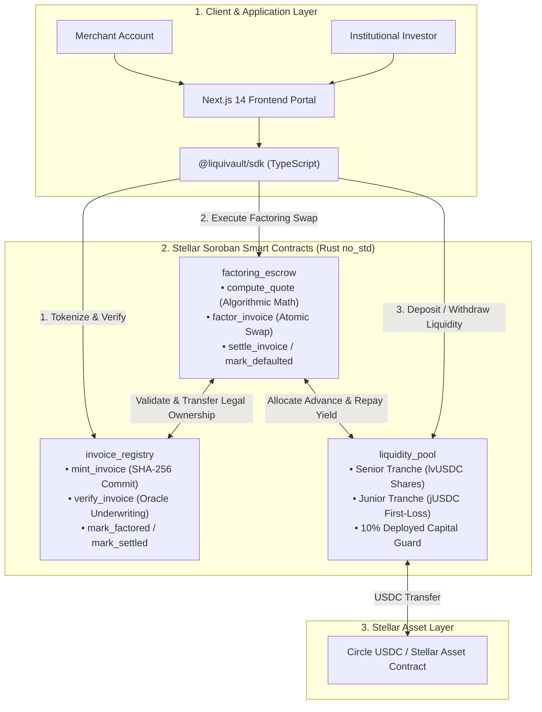

# LiquiVault Protocol

[](LICENSE)
[](https://stellar.org)
[](https://soroban.stellar.org)
[](https://www.rust-lang.org)
[](docs/EVIDENCE.md)
[](./liquivault-sdk)
[](./liquivault-frontend)

**Institutional-Grade Decentralized Trade Receivables Tokenization & Tranched Liquidity Vault on Stellar Soroban**

LiquiVault enables global SMEs and institutional merchants to tokenize unpaid trade receivables on Stellar Soroban, commit cryptographic document hashes, and atomically swap them for immediate USDC liquidity at an algorithmic, risk-adjusted discount. Capital is backed by an automated, tranched liquidity pool offering protected senior yields (`lvUSDC`) and outsized first-loss junior yields (`jUSDC`).

**Tested scope:** Stellar Protocol 21/22, Soroban SDK 21.7.7, Rust 1.80+ (target `wasm32-unknown-unknown`), Node.js v20/v22 x64, Stellar CLI 21.7+. See [Verified Evidence](docs/EVIDENCE.md), [Storage & TTL Policy](docs/storage.md), [Security Policy](docs/SECURITY.md), and [Known Limitations](docs/KNOWN_LIMITATIONS.md).

---

## Why LiquiVault

Global trade credit exceeds **$5 trillion annually** locked in unpaid Net-30, Net-60, and Net-90 invoices. Traditional invoice factoring suffers from:
1. **Predatory Cost Structures**: Traditional factoring intermediaries charge opaque double-digit fees with hidden administrative charges.
2. **Slow Settlement**: Approval and wire transfer latency regularly takes 5 to 14 banking days.
3. **Double-Pledging Fraud**: Invoices can be pledged to multiple lenders because no unified, tamper-proof registry exists.
4. **Binary Risk Profiles**: Un-tranched DeFi lending pools expose all passive liquidity providers equally to delinquent borrower defaults.

**LiquiVault resolves these bottlenecks on Stellar Soroban:**
- **Instant Atomic Liquidity**: Sub-second execution releases USDC advances directly to merchants.
- **Transparent Algorithmic Pricing**: Pricing is deterministic based on elapsed duration and oracle-verified credit risk tiers.
- **Cryptographic Fraud Prevention**: Immutable SHA-256 metadata commitments (`BytesN<32>`) and on-chain ownership transfer eliminate double-factoring.
- **Tranched First-Loss Capital Protection**: Defaults are 100% absorbed by the junior tranche before senior liquidity provider principal is touched.

---

## How It Works



### Complete Protocol Execution Flow
```text
1. Tokenization: Merchant calls invoice_registry.mint_invoice with face value, maturity, debtor, and SHA-256 metadata hash.
   └── Status: Issued (0)
2. Oracle Underwriting: Authorized Verifier Oracle audits off-chain documents and calls verify_invoice with RiskTier (TierA/B/C).
   └── Status: Verified (1) [Self-verification by merchant or debtor strictly disallowed]
3. Algorithmic Factoring: Merchant invokes factoring_escrow.factor_invoice.
   ├── Validates status, maturity, and USDC currency.
   ├── Calculates time-weighted discount + origination fee in Soroban checked math.
   ├── Transfers legal invoice ownership from merchant to escrow contract.
   └── liquidity_pool releases net USDC payout directly to merchant wallet.
   └── Status: Factored (2)
4. Maturity Settlement: Debtor repays invoice face value via factoring_escrow.settle_invoice.
   ├── Advance principal returned to pool.
   ├── 10% reserve cut routed to protocol treasury.
   ├── 30% of net yield routed to Junior Tranche (jUSDC).
   ├── 70% of net yield routed to Senior Tranche (lvUSDC).
   └── Status: Settled (3)
5. Delinquency Default: If unpaid after maturity + 7-day grace period, admin invokes mark_defaulted.
   ├── Junior Tranche absorbs 100% of loss up to junior assets.
   ├── Senior Tranche absorbs residual loss only if junior is exhausted.
   └── Status: Defaulted (4)
```

---

## Concrete Factoring & Tranche Economics Example

The table below reflects real numbers validated in our automated test suite (`test_end_to_end_factoring_and_settlement` and `test_junior_receives_share_of_yield`):

### Scenario Parameters
- **Invoice Face Value**: `100,000.0000000 USDC` (100,000 USDC)
- **Tenor / Duration**: `73 Days` (Net-73 terms)
- **Assigned Risk Tier**: `Tier B` (10.00% APR = 1,000 bps)
- **Origination Fee**: `0.50%` (50 bps)
- **Pool Liquidity**: Senior Vault (`60,000 USDC`), Junior Vault (`20,000 USDC`)

| Financial Dimension | Exact Value (Stroops / USDC) | Formula / Calculation |
| :--- | :--- | :--- |
| **Duration in Seconds** | `6,307,200 s` | $73 \times 86{,}400$ seconds |
| **Time-Weighted Discount** | **2,000.0000000 USDC** | $\frac{100{,}000 \times 1{,}000 \times 6{,}307{,}200}{10{,}000 \times 31{,}536{,}000}$ |
| **Origination Fee** | **500.0000000 USDC** | $\frac{100{,}000 \times 50}{10{,}000}$ |
| **Total Factoring Discount** | **2,500.0000000 USDC** | $2{,}000 + 500$ USDC (Gross yield) |
| **Net Merchant Payout** | **97,500.0000000 USDC** | $100{,}000 - 2{,}500$ USDC (Instant liquidity) |
| **Protocol Reserve Cut (10%)** | **250.0000000 USDC** | Routed to Protocol Treasury reserve |
| **Net LP Factoring Yield** | **2,250.0000000 USDC** | Distributed pro-rata to vault tranches |
| **Junior Tranche Yield (30%)** | **675.0000000 USDC** | $30\% \times 2{,}250$ (Outsized yield on 20k capital) |
| **Senior Tranche Yield (70%)** | **1,575.0000000 USDC** | $70\% \times 2{,}250$ (Protected yield on 60k capital) |

### Default Write-Off Absorption
If an advance of `15,000 USDC` defaults past the 7-day grace period:
- **Junior Capital ($20,000 \longrightarrow \$5,000$)**: Absorbs **100% of the loss** ($15,000$ USDC).
- **Senior Capital ($60,000 \longrightarrow \$60,000$)**: **0% Loss**. Senior LP principal is completely insulated.

---

## Repository Structure

LiquiVault is structured as a modular monorepo:

| Directory | Component | Tech Stack | Role & Responsibilities |
| :--- | :--- | :--- | :--- |
| [`./liquivault-contracts`](./liquivault-contracts) | Soroban Smart Contracts | Rust (`#![no_std]`), `soroban-sdk 21.7.7` | `invoice_registry`, `liquidity_pool`, and `factoring_escrow`. Checked math, CEI pattern, state TTL extension. |
| [`./liquivault-sdk`](./liquivault-sdk) | TypeScript Client SDK | TypeScript, `@stellar/stellar-sdk`, `tsup`, `vitest` | Dual ESM/CJS build. Typed contract clients, Soroban XDR transaction builders, Freighter SEP-10 wallet adapter. |
| [`./liquivault-frontend`](./liquivault-frontend) | Web Application | Next.js 14 (App Router), Tailwind, `shadcn/ui` | Institutional portals: Merchant Factoring Portal, Investor Liquidity Vault, and Protocol Telemetry Dashboard. |
| [`./docs`](./docs) | Architecture & Specs | Markdown | Full technical specifications, storage layout, security threat model, evidence, and deployment runbooks. |

---

## Quick Start

### 1. Smart Contracts (`liquivault-contracts`)
Provision Rust `1.80.0+` with target `wasm32-unknown-unknown` and `stellar-cli` `21.7.0+`:
```bash
cd liquivault-contracts

# Execute full workspace unit and integration test suite (19 tests)
cargo test --workspace

# Build optimized release Soroban WASM binaries
stellar contract build
```

### 2. TypeScript SDK (`liquivault-sdk`)
Provision Node.js v20.x or v22.x:
```bash
cd liquivault-sdk

# Install dependencies
npm install

# Run SDK unit tests (11 tests)
npm test

# Build ESM and CJS distributions
npm run build
```

**SDK Usage Example:**
```typescript
import { LiquiVaultSDK, RiskTier } from '@liquivault/sdk';

const sdk = new LiquiVaultSDK({
  network: {
    network: 'testnet',
    rpcUrl: 'https://soroban-testnet.stellar.org',
    horizonUrl: 'https://horizon-testnet.stellar.org',
    networkPassphrase: 'Test SDF Network ; September 2015',
  },
  contracts: {
    invoiceRegistry: 'CBREGISTRY...',
    liquidityPool: 'CBPOOL...',
    factoringEscrow: 'CBESCROW...',
    usdcToken: 'CBUSDC...',
  },
});

// Calculate algorithmic factoring quote offline
const quote = sdk.factoringEscrow.calculateAlgorithmicDiscount(
  1n,
  100_000_0000000n, // 100,000 USDC
  RiskTier.TierB,    // 10.00% APR
  Math.floor(Date.now() / 1000) + 86400 * 73 // 73 days maturity
);

console.log('Discount:', quote.totalDiscount); // 2,500 USDC
console.log('Instant Net Payout:', quote.netPayout); // 97,500 USDC
```

### 3. Web Application (`liquivault-frontend`)
```bash
cd liquivault-frontend

# Configure environment variables
cp .env.example .env.local

# Install dependencies
npm install

# Run frontend unit tests (12 tests)
npm test

# Launch development server
npm run dev
```
Open [http://localhost:3000](http://localhost:3000) in your browser.

---

## Security Model & Invariant Guarantees

Every transaction executed by LiquiVault satisfies four core architectural invariants:

1. **Checks-Effects-Interactions (CEI)**: All internal balances and contract storage keys are mutated before initiating token transfers or cross-contract invocations.
2. **Checked 128-Bit Arithmetic**: All operations use `checked_add`, `checked_sub`, `checked_mul`, and `checked_div`. Overflows immediately revert with `ArithmeticOverflow`.
3. **Strict Underwriting Access Control (Finding F-1)**: Only the authorized Verifier Oracle or Contract Admin can invoke `verify_invoice`. Self-verification by merchants or debtors is permanently prohibited.
4. **Tranche Capital Coverage (Finding F-3)**: Junior redemptions are locked unless remaining junior capital maintains at least 10% coverage over outstanding deployed invoice advances:
   $$\text{Remaining Junior Assets} \ge \text{Deployed Capital} \times 10\%$$

For a detailed review of all security findings (F-1 through F-7) and threat model assumptions, see [Security Policy](docs/SECURITY.md).

---

## Test Evidence & Mathematical Proofs

The protocol is backed by **42 automated unit and integration tests** passing with 0 failures:
- **19 Contract Tests** in Rust covering factoring math, double-factoring prevention, pause controls, two-step admin transfers, and junior/senior tranche yield/loss splits.
- **11 SDK Tests** in TypeScript verifying SHA-256 metadata hashing, XDR operation envelope generation, and quote calculations.
- **12 Frontend Tests** in React Testing Library verifying telemetry rendering, invoice forms, and junior tranche cards.

See the complete verification report in [Verified Evidence](docs/EVIDENCE.md).

---

## Complete Documentation Index

| Document | Purpose & Description |
| :--- | :--- |
| [**Architecture Specification**](docs/architecture.md) | Detailed system topology, sequence diagrams, state machine, and algorithmic pricing mathematics. |
| [**Verified Evidence**](docs/EVIDENCE.md) | Full test execution logs, test case matrix, and verified mathematical proofs. |
| [**Storage & TTL Lifecycle Policy**](docs/storage.md) | Exhaustive DataKey registry, Instance vs Persistent storage tiers, TTL bump constants, and archival recovery runbook. |
| [**Security Policy & Threat Model**](docs/SECURITY.md) | Vulnerability disclosure SLA, trust boundary matrix, in-depth analysis of Findings F-1 to F-7, and formal invariants. |
| [**Known Limitations & Boundaries**](docs/KNOWN_LIMITATIONS.md) | Operational envelope, tested versions, economic boundaries, and pre-mainnet roadmap. |
| [**Testnet Deployment Runbook**](docs/deployment.md) | Step-by-step Stellar CLI deployment, contract initialization parameters, and cross-binding commands. |
| [**Contributing Guidelines**](CONTRIBUTING.md) | Monorepo developer guide, branching conventions, pull request checklist, and code standards. |
| [**Code of Conduct**](CODE_OF_CONDUCT.md) | Contributor Covenant v2.1 community standards. |

---

## License

This project is licensed under the [Apache License 2.0](LICENSE).
