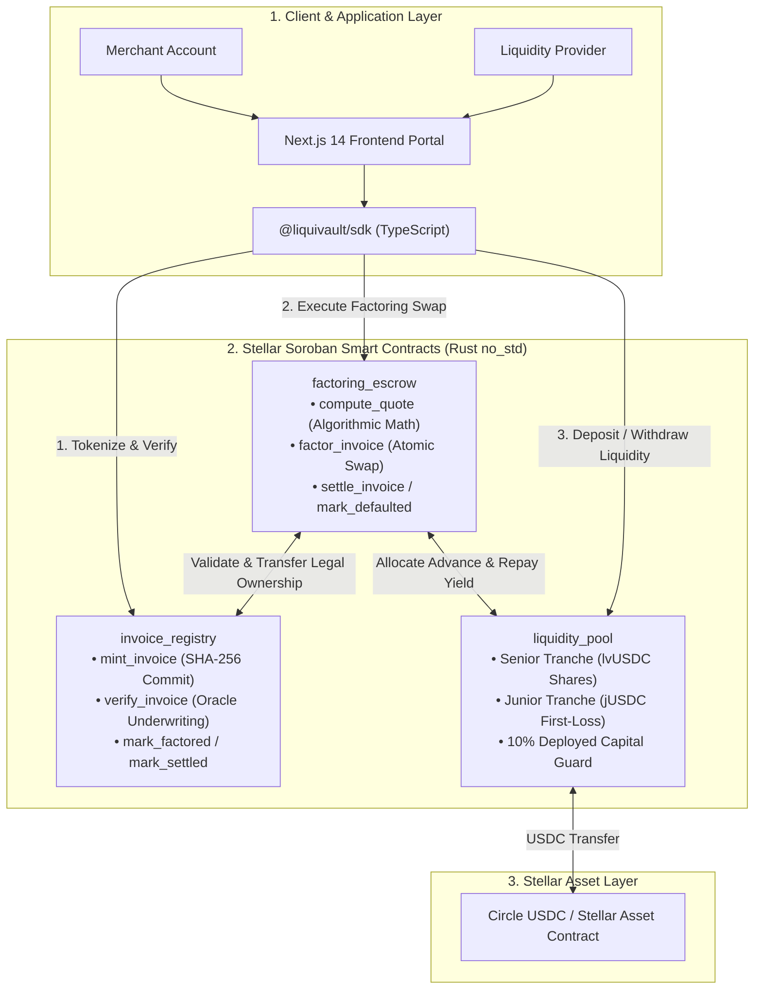

# LiquiVault Protocol

[](LICENSE)
[](docs/deployment.md#0-live-testnet-deployment)
[](https://soroban.stellar.org)
[](docs/EVIDENCE.md)
[](docs/SECURITY.md)

**Invoice factoring on Stellar Soroban with a two-tranche liquidity pool: junior LPs take first loss for higher yield, senior LPs get protected principal.**

Merchants tokenize unpaid invoices (with a SHA-256 hash of the supporting documents), get them risk-graded by a verifier oracle, and swap them for USDC at a deterministic, risk-adjusted discount. The USDC comes from a pool split into a **senior tranche** and a **junior tranche**. Defaults hit junior capital first; junior LPs are paid a larger share of yield for taking that risk.

> **Status:** Early-stage, pre-audit, **testnet only**. Do not use with real funds. See [Known Limitations](docs/KNOWN_LIMITATIONS.md) and [Security Policy](docs/SECURITY.md).

---

## What Makes LiquiVault Different

Several Stellar projects already finance invoices from a pool (for example TrusTrove, Kora, ClearLedger, and Invoice Liquidity Network). In those designs every liquidity provider shares default losses equally, or losses are covered by a separate insurance pool.

LiquiVault instead **tranches the pool itself**, the way structured credit funds do:

| | Senior tranche | Junior tranche |
| :--- | :--- | :--- |
| Who it suits | LPs who want capital protection | LPs who want higher yield and accept first loss |
| Share of net yield | 70% (configurable) | 30% (configurable, max 80%) |
| On default | Touched only after junior is wiped out | Absorbs losses first |
| Withdrawals | Anytime, against idle liquidity | Locked while junior would fall below 10% of deployed capital |

This lets one pool serve two very different kinds of investor, and gives senior LPs a cushion against bad invoices. The rules are enforced in `liquidity_pool` and covered by the tests `test_junior_absorbs_losses_before_senior`, `test_junior_receives_share_of_yield`, and `test_junior_withdrawal_requires_coverage_of_deployed_capital`.

---

## Live on Stellar Testnet

| Contract | Testnet ID |
| :--- | :--- |
| `invoice_registry` | [`CBYTATTI4S32LCK5W2N4P6U64MAGROW5ZH7DOXAO4CIOY2KWDNIDLSQY`](https://stellar.expert/explorer/testnet/contract/CBYTATTI4S32LCK5W2N4P6U64MAGROW5ZH7DOXAO4CIOY2KWDNIDLSQY) |
| `liquidity_pool` | [`CCRZRIUMDZ67YDHWMPUFO2LZNGKS2QDRPNK23MUVBYMXYHDDQNNDULGR`](https://stellar.expert/explorer/testnet/contract/CCRZRIUMDZ67YDHWMPUFO2LZNGKS2QDRPNK23MUVBYMXYHDDQNNDULGR) |
| `factoring_escrow` | [`CBQGNTVLNXV2LZ47GTOUK2TQNTNBNWUWSAKXVYHCURAVL7UZENQ7U42C`](https://stellar.expert/explorer/testnet/contract/CBQGNTVLNXV2LZ47GTOUK2TQNTNBNWUWSAKXVYHCURAVL7UZENQ7U42C) |
| Test USDC (not Circle) | [`CCELQDGSNDDQHVDXQM3CXBCR4LOGLVAIKKET4RY72MZP7SKTEOY2RO2K`](https://stellar.expert/explorer/testnet/contract/CCELQDGSNDDQHVDXQM3CXBCR4LOGLVAIKKET4RY72MZP7SKTEOY2RO2K) |

A full on-chain smoke test (deposit → mint → verify → factor → settle) ran against this deployment: a 10,000 USDC, 60-day, Tier B invoice paid the merchant 9,785.62 USDC, and on settlement the 1,929.44 USDC LP yield split 578.83 to junior and 1,350.61 to senior. Results: [`deployments/testnet.json`](liquivault-contracts/deployments/testnet.json). Redeploy with [`scripts/deploy_testnet.sh`](liquivault-contracts/scripts/deploy_testnet.sh); see the [Deployment Guide](docs/deployment.md).

---

## Why LiquiVault

Small businesses often wait 30–90 days to be paid on invoices. Traditional invoice factoring has well-known problems:
1. **High, opaque fees** charged by intermediaries.
2. **Slow approval and settlement**, often days to weeks.
3. **Double-pledging fraud**: the same invoice can be pledged to several lenders when there is no shared registry.
4. **One-size-fits-all risk**: in an un-tranched pool, every LP is equally exposed to defaults.

**How LiquiVault addresses them:**
- **Fast settlement**: factoring is a single Soroban transaction; USDC reaches the merchant when it confirms (seconds on Stellar).
- **Transparent pricing**: the discount is a published formula of time to maturity and the oracle-assigned risk tier.
- **Double-factoring prevention**: each invoice carries a SHA-256 document hash (`BytesN<32>`), and factoring transfers on-chain ownership to the escrow, so the same invoice cannot be factored twice through LiquiVault.
- **Tranched risk**: defaults are absorbed by the junior tranche before senior principal is touched.

---

## How It Works



### Complete Protocol Execution Flow
```text
1. Tokenization: Merchant calls invoice_registry.mint_invoice with face value, maturity, debtor, and SHA-256 metadata hash.
   └── Status: Issued (0)
2. Oracle Underwriting: Authorized Verifier Oracle audits off-chain documents and calls verify_invoice with RiskTier (TierA/B/C).
   └── Status: Verified (1) [Self-verification by merchant or debtor strictly disallowed]
3. Algorithmic Factoring: Merchant invokes factoring_escrow.factor_invoice.
   ├── Validates status, maturity, and USDC currency.
   ├── Calculates time-weighted discount + origination fee in Soroban checked math.
   ├── Transfers legal invoice ownership from merchant to escrow contract.
   └── liquidity_pool releases net USDC payout directly to merchant wallet.
   └── Status: Factored (2)
4. Maturity Settlement: Debtor repays invoice face value via factoring_escrow.settle_invoice.
   ├── Advance principal returned to pool.
   ├── 10% reserve cut routed to protocol treasury.
   ├── 30% of net yield routed to Junior Tranche (jUSDC).
   ├── 70% of net yield routed to Senior Tranche (lvUSDC).
   └── Status: Settled (3)
5. Delinquency Default: If unpaid after maturity + 7-day grace period, admin invokes mark_defaulted.
   ├── Junior Tranche absorbs 100% of loss up to junior assets.
   ├── Senior Tranche absorbs residual loss only if junior is exhausted.
   └── Status: Defaulted (4)
```

---

## Concrete Factoring & Tranche Economics Example

A worked example using the default rate configuration. The discount, fee, payout, and 10% reserve figures are asserted in `test_end_to_end_factoring_and_settlement`; the 30/70 tranche split follows the rule asserted in `test_junior_receives_share_of_yield` (which uses a 2,000 USDC yield).

### Scenario Parameters
- **Invoice Face Value**: `100,000.0000000 USDC` (100,000 USDC)
- **Tenor / Duration**: `73 Days` (Net-73 terms)
- **Assigned Risk Tier**: `Tier B` (10.00% APR = 1,000 bps)
- **Origination Fee**: `0.50%` (50 bps)
- **Pool Liquidity**: Senior Vault (`150,000 USDC`), Junior Vault (`50,000 USDC`)

| Financial Dimension | Exact Value (Stroops / USDC) | Formula / Calculation |
| :--- | :--- | :--- |
| **Duration in Seconds** | `6,307,200 s` | $73 \times 86{,}400$ seconds |
| **Time-Weighted Discount** | **2,000.0000000 USDC** | $\frac{100{,}000 \times 1{,}000 \times 6{,}307{,}200}{10{,}000 \times 31{,}536{,}000}$ |
| **Origination Fee** | **500.0000000 USDC** | $\frac{100{,}000 \times 50}{10{,}000}$ |
| **Total Factoring Discount** | **2,500.0000000 USDC** | $2{,}000 + 500$ USDC (Gross yield) |
| **Net Merchant Payout** | **97,500.0000000 USDC** | $100{,}000 - 2{,}500$ USDC (Instant liquidity) |
| **Protocol Reserve Cut (10%)** | **250.0000000 USDC** | Routed to Protocol Treasury reserve |
| **Net LP Factoring Yield** | **2,250.0000000 USDC** | Split 30% junior / 70% senior |
| **Junior Tranche Yield (30%)** | **675.0000000 USDC** | $30\% \times 2{,}250$ (1.35% on 50k junior capital over 73 days) |
| **Senior Tranche Yield (70%)** | **1,575.0000000 USDC** | $70\% \times 2{,}250$ (1.05% on 150k senior capital over 73 days) |

### Default Write-Off Absorption
With a pool of 60,000 USDC senior and 20,000 USDC junior (the setup in `test_junior_absorbs_losses_before_senior`), if an advance of `15,000 USDC` defaults past the 7-day grace period:
- **Junior Capital ($20,000 \longrightarrow \$5,000$)**: Absorbs **100% of the loss** ($15,000$ USDC).
- **Senior Capital ($60,000 \longrightarrow \$60,000$)**: **0% Loss**. Senior principal is untouched while junior capital remains (asserted in `test_junior_absorbs_losses_before_senior`).

---

## Repository Structure

LiquiVault is structured as a modular monorepo:

| Directory | Component | Tech Stack | Role & Responsibilities |
| :--- | :--- | :--- | :--- |
| [`./liquivault-contracts`](./liquivault-contracts) | Soroban Smart Contracts | Rust (`#![no_std]`), `soroban-sdk 21.7.7` | `invoice_registry`, `liquidity_pool`, and `factoring_escrow`. Checked math, CEI pattern, state TTL extension. |
| [`./liquivault-sdk`](./liquivault-sdk) | TypeScript Client SDK | TypeScript, `@stellar/stellar-sdk`, `tsup`, `vitest` | Dual ESM/CJS build. Typed contract clients, Soroban XDR transaction builders, Freighter SEP-10 wallet adapter. |
| [`./liquivault-frontend`](./liquivault-frontend) | Web Application | Next.js 14 (App Router), Tailwind, `shadcn/ui` | Merchant Factoring Portal, Investor Liquidity Vault, and Protocol Dashboard. |
| [`./docs`](./docs) | Architecture & Specs | Markdown | Full technical specifications, storage layout, security threat model, evidence, and deployment runbooks. |

---

## Quick Start

### 1. Smart Contracts (`liquivault-contracts`)
Requires Rust `1.84+` with the `wasm32v1-none` target and `stellar-cli` `22+`:
```bash
cd liquivault-contracts

# Execute full workspace unit and integration test suite (19 tests)
cargo test --workspace

# Build release WASM (crates are rlib for host tests, so request cdylib explicitly)
for c in invoice_registry liquidity_pool factoring_escrow; do
  cargo rustc -p $c --crate-type cdylib --target wasm32v1-none --release
done

# Or build, deploy to testnet, and run the end-to-end smoke test in one go
./scripts/deploy_testnet.sh
```

### 2. TypeScript SDK (`liquivault-sdk`)
Provision Node.js v20.x or v22.x:
```bash
cd liquivault-sdk

# Install dependencies
npm install

# Run SDK unit tests (11 tests)
npm test

# Build ESM and CJS distributions
npm run build
```

**SDK Usage Example:**
```typescript
import { LiquiVaultSDK, RiskTier } from '@liquivault/sdk';

const sdk = new LiquiVaultSDK({
  network: {
    network: 'testnet',
    rpcUrl: 'https://soroban-testnet.stellar.org',
    horizonUrl: 'https://horizon-testnet.stellar.org',
    networkPassphrase: 'Test SDF Network ; September 2015',
  },
  contracts: {
    // Live testnet deployment (see docs/deployment.md)
    invoiceRegistry: 'CBYTATTI4S32LCK5W2N4P6U64MAGROW5ZH7DOXAO4CIOY2KWDNIDLSQY',
    liquidityPool: 'CCRZRIUMDZ67YDHWMPUFO2LZNGKS2QDRPNK23MUVBYMXYHDDQNNDULGR',
    factoringEscrow: 'CBQGNTVLNXV2LZ47GTOUK2TQNTNBNWUWSAKXVYHCURAVL7UZENQ7U42C',
    usdcToken: 'CCELQDGSNDDQHVDXQM3CXBCR4LOGLVAIKKET4RY72MZP7SKTEOY2RO2K', // test USDC
  },
});

// Calculate algorithmic factoring quote offline
const quote = sdk.factoringEscrow.calculateAlgorithmicDiscount(
  1n,
  100_000_0000000n, // 100,000 USDC
  RiskTier.TierB,    // 10.00% APR
  Math.floor(Date.now() / 1000) + 86400 * 73 // 73 days maturity
);

console.log('Discount:', quote.totalDiscount); // 2,500 USDC
console.log('Instant Net Payout:', quote.netPayout); // 97,500 USDC
```

### 3. Web Application (`liquivault-frontend`)
```bash
cd liquivault-frontend

# Configure environment variables
cp .env.example .env.local

# Install dependencies
npm install

# Run frontend unit tests (12 tests)
npm test

# Launch development server
npm run dev
```
Open [http://localhost:3000](http://localhost:3000) in your browser.

---

## Security Model & Invariant Guarantees

The contracts are designed around four invariants (pre-audit; see [Security Policy](docs/SECURITY.md)):

1. **Checks-Effects-Interactions (CEI)**: All internal balances and contract storage keys are mutated before initiating token transfers or cross-contract invocations.
2. **Checked 128-Bit Arithmetic**: All operations use `checked_add`, `checked_sub`, `checked_mul`, and `checked_div`. Overflows immediately revert with `ArithmeticOverflow`.
3. **Strict Underwriting Access Control (Finding F-1)**: Only the authorized Verifier Oracle or Contract Admin can invoke `verify_invoice`. Self-verification by merchants or debtors is permanently prohibited.
4. **Tranche Capital Coverage (Finding F-3)**: Junior redemptions are locked unless remaining junior capital maintains at least 10% coverage over outstanding deployed invoice advances:
   $$\text{Remaining Junior Assets} \ge \text{Deployed Capital} \times 10\%$$

For a detailed review of all security findings (F-1 through F-7) and threat model assumptions, see [Security Policy](docs/SECURITY.md).

---

## Test Evidence & Mathematical Proofs

The protocol is backed by **42 automated unit and integration tests** passing with 0 failures:
- **19 Contract Tests** in Rust covering factoring math, double-factoring prevention, pause controls, dual-signature admin transfers, and junior/senior tranche yield/loss splits.
- **11 SDK Tests** in TypeScript verifying SHA-256 metadata hashing, XDR operation envelope generation, and quote calculations.
- **12 Frontend Tests** in React Testing Library verifying telemetry rendering, invoice forms, and junior tranche cards.

See the complete verification report in [Verified Evidence](docs/EVIDENCE.md).

---

## Complete Documentation Index

| Document | Purpose & Description |
| :--- | :--- |
| [**Architecture Specification**](docs/architecture.md) | Detailed system topology, sequence diagrams, state machine, and algorithmic pricing mathematics. |
| [**Verified Evidence**](docs/EVIDENCE.md) | Full test execution logs, test case matrix, and verified mathematical proofs. |
| [**Storage & TTL Lifecycle Policy**](docs/storage.md) | Exhaustive DataKey registry, Instance vs Persistent storage tiers, TTL bump constants, and archival recovery runbook. |
| [**Security Policy & Threat Model**](docs/SECURITY.md) | Vulnerability disclosure SLA, trust boundary matrix, in-depth analysis of Findings F-1 to F-7, and formal invariants. |
| [**Known Limitations & Boundaries**](docs/KNOWN_LIMITATIONS.md) | Operational envelope, tested versions, economic boundaries, and pre-mainnet roadmap. |
| [**Testnet Deployment Runbook**](docs/deployment.md) | Live testnet contract IDs, one-command deploy script, and manual Stellar CLI steps. |
| [**Contributing Guidelines**](CONTRIBUTING.md) | Monorepo developer guide, branching conventions, pull request checklist, and code standards. |
| [**Code of Conduct**](CODE_OF_CONDUCT.md) | Contributor Covenant v2.1 community standards. |

---

## License

This project is licensed under the [Apache License 2.0](LICENSE).
