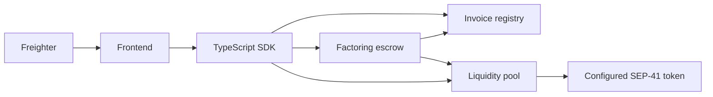

# Architecture

LiquiVault has a Next.js frontend, a TypeScript SDK and three Soroban contracts. [Known limitations](KNOWN_LIMITATIONS.md) and [security assumptions](SECURITY.md) apply throughout.



## Registry

`mint_invoice` records merchant, debtor, currency, positive `i128` face value, future `u64` maturity, `BytesN<32>` metadata commitment, invoice number and risk tier. IDs are `u64`. The configured verifier or admin alone can verify. Ownership and status constrain factoring; only the configured escrow can mark a record factored, settled or defaulted.

States are `Issued -> Verified -> Factored -> Settled | Defaulted`. Ownership transfers for unfactored records are separate from status transitions. A metadata commitment is not document verification or protection against minting another record representing the same invoice.

## Escrow and pricing

Escrow validates ownership, verification, currency and maturity. Let `F` be face value, `a` annual risk-tier bps, `d` seconds until maturity and `o` origination bps:

```text
time_discount = floor(F * a * d / (10000 * 31536000))
origination_fee = floor(F * o / 10000)
total_discount = time_discount + origination_fee
net_payout = F - total_discount
```

Expired invoices and discounts at least as large as face value are rejected. Administrators set rates; the demonstration configuration uses 600/1000/1500 annual bps and 50 origination bps. Use `preview_factoring_quote` for current configuration; an offline estimate is not an executable promise.

On factoring, escrow stores the exact payout and discount, marks the invoice factored and requests the pool advance. On repayment, a payer transfers the original face value through principal/yield routing. Repayment is allowed before maturity and while escrow is paused. On default, the admin must wait until strictly after maturity plus the configured grace period. Registry, escrow and pool updates occur atomically or the transaction reverts.

## Pool accounting

Senior totals are in `PoolState`; junior totals are in `JuniorState`. `deployed_capital` tracks all outstanding advances. Assets include capital out on invoices:

```text
idle = senior_assets + junior_assets - deployed_capital
protocol_cut = floor(gross_yield * reserve_factor_bps / 10000)
lp_yield = gross_yield - protocol_cut
capital_bps = floor(junior_assets * 10000 / (junior_assets + senior_assets))
effective_junior_bps = min(configured_junior_bps, capital_bps)
junior_yield = floor(lp_yield * effective_junior_bps / 10000)
senior_yield = lp_yield - junior_yield
```

With no junior capital, junior yield is zero. Default losses consume junior assets first, then senior assets. New shares are proportional to existing assets and shares. Zero-assets tranches with outstanding shares reject new deposits; there is no automatic recapitalization.

Both withdrawal functions require sufficient shares and idle liquidity, and at least 86,400 seconds since that provider's latest deposit in the relevant tranche. A top-up relocks existing shares. Junior withdrawals must also leave capital covering at least 10% of deployed advances. Withdrawals may remain impossible after the time lock if capital is deployed or coverage is insufficient.

## Client execution

The SDK builds real Stellar transactions using a funded source account's current sequence, a fee and timeout. `rpc.Server.prepareTransaction` applies the simulation's footprint, auth and resource fee before the wallet signs. The SDK rejects a changed signed body, submits, then polls for the confirmed result. Pending submission is not success. Concurrent writes from one account must be serialized; inspect the hash before retrying an ambiguous submission.

Reads simulate contract operations without signing. They do not persist ledger state or renew storage rent. Contract `snake_case` fields become SDK `camelCase`; IDs and amounts stay bigint, timestamps become numbers, and numeric enums become SDK enums.

The frontend refreshes snapshots every 30 seconds. It lists the connected merchant's invoices and confirmed activity from the current session. It has no historic indexer, automatic verifier, SEP-10/KYB integration or SEP-24 anchor flow.
