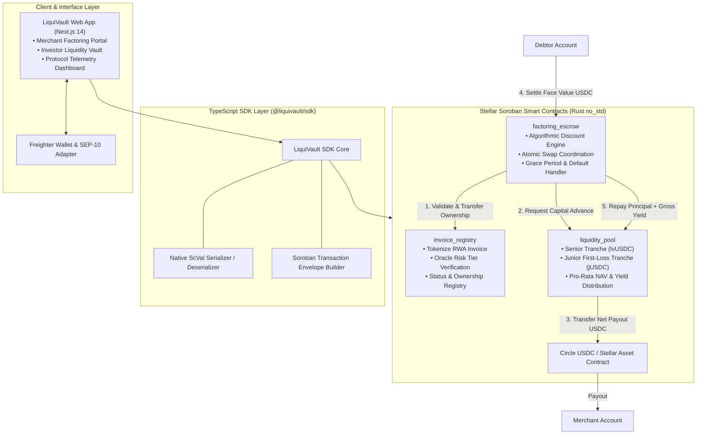
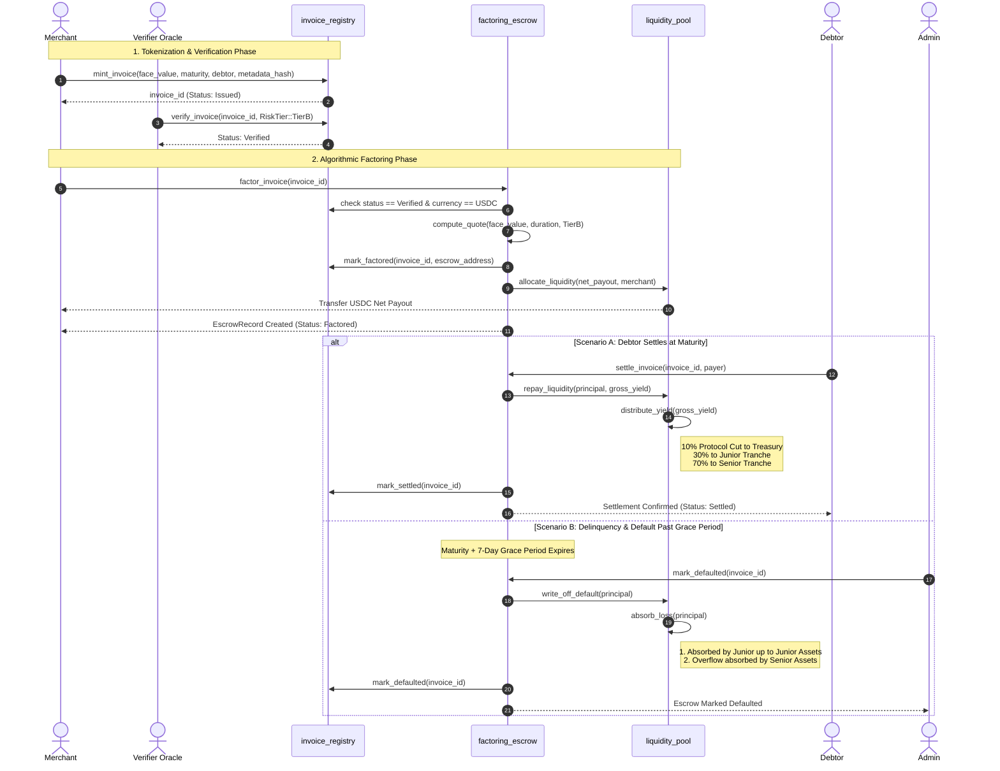
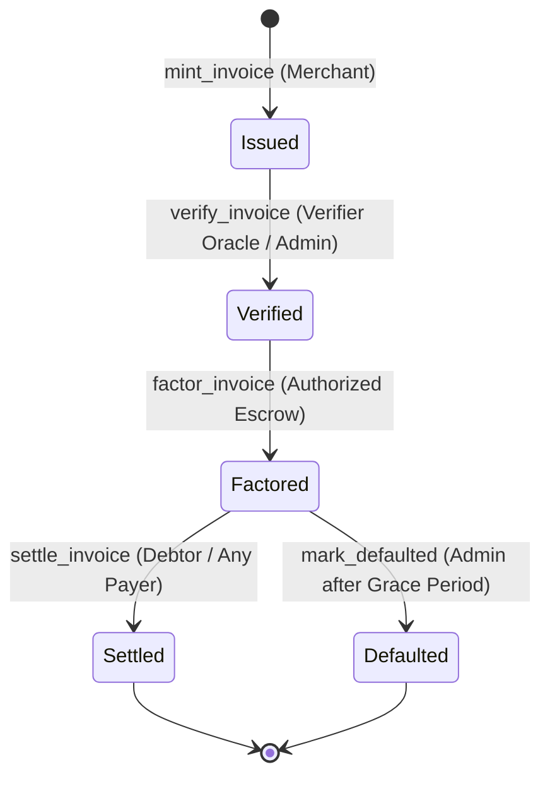
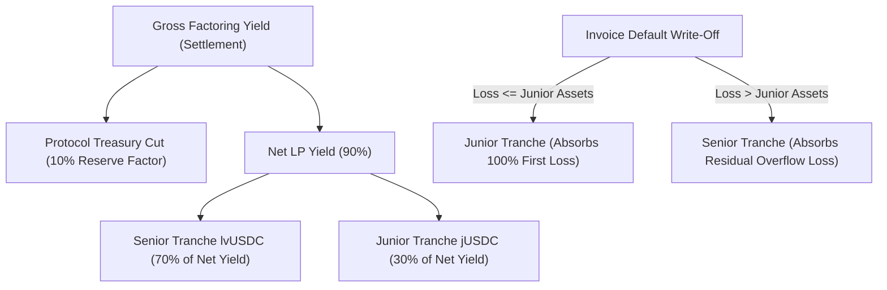

# LiquiVault Protocol Architecture

LiquiVault is an institutional-grade, decentralized trade receivables tokenization and liquidity vault protocol built on **Stellar Soroban** (`#![no_std]`, `soroban-sdk = "21.7.7"`). It provides global SMEs and corporate merchants with instantaneous, risk-adjusted USDC working capital backed by an automated, tranched liquidity pool.

See [Verified Evidence](EVIDENCE.md) for concrete test proofs, [Storage & TTL Policy](storage.md) for ledger footprint details, and [Known Limitations](KNOWN_LIMITATIONS.md) for operational boundaries.

---

## 1. System Topology & Architectural Model

The protocol comprises three modular layers: an institutional Next.js 14 frontend, a typed TypeScript SDK with native XDR builders, and three core Soroban smart contracts.

---

## 2. End-to-End Invoice Factoring Lifecycle

The diagram below details the sequence of transactions and checks from initial invoice issuance to maturity settlement or default write-off.

---

## 3. Invoice State Machine

The tokenized invoice moves through strict, one-way state transitions enforced by caller role verification:

* **Issued (0)**: Initial tokenization by the merchant with SHA-256 metadata hash.
* **Verified (1)**: Underwriting complete. Credit risk tier assigned. Self-verification by merchant or debtor is strictly rejected.
* **Factored (2)**: Factoring discount computed, net USDC advance transferred to merchant, legal invoice ownership transferred to escrow.
* **Settled (3)**: Debtor repaid face value; principal and yield routed to the liquidity pool.
* **Defaulted (4)**: Maturity plus grace period expired without payment; pool absorbs defaulted advance.

---

## 4. Algorithmic Pricing Mathematics

The factoring discount balances time value of money against credit underwriting risk:

$$\text{Duration} = \text{Maturity Timestamp} - \text{Current Timestamp}$$

$$\text{Time Discount} = \frac{\text{Face Value} \times \text{Annual Rate (bps)} \times \text{Duration (seconds)}}{10{,}000 \times 31{,}536{,}000}$$

$$\text{Origination Fee} = \frac{\text{Face Value} \times \text{Origination Fee (bps)}}{10{,}000}$$

$$\text{Total Factoring Discount} = \text{Time Discount} + \text{Origination Fee}$$

$$\text{Net Merchant Payout} = \text{Face Value} - \text{Total Factoring Discount}$$

### Credit Risk Tiers (Default Configuration)
* **Tier A**: Low Risk (High Credit Rating Debtor) $\longrightarrow$ **6.00% APR** (600 bps) + 50 bps Origination.
* **Tier B**: Medium Risk (Standard SME Receivable) $\longrightarrow$ **10.00% APR** (1,000 bps) + 50 bps Origination.
* **Tier C**: High Risk / Emerging Market SME $\longrightarrow$ **15.00% APR** (1,500 bps) + 50 bps Origination.

---

## 5. Tranched Liquidity Pool & Loss Waterfall

The `liquidity_pool` manages two distinct risk/reward tranches:

### 5.1 Senior Tranche (`lvUSDC`)
- **Pro-Rata Share NAV**: Share price is determined dynamically:
  $$\text{Share Price} = \frac{\text{Total Senior Assets} \times 10{,}000{,}000}{\text{Total Senior Shares}}$$
- **Capital Protection**: Defaults only reduce senior assets after the junior first-loss tranche has been 100% wiped out.
- **Liquidity Buffer**: Senior withdrawals can access idle liquidity from both senior and junior deposits.

### 5.2 Junior First-Loss Tranche (`jUSDC`)
- **Higher Yield**: Earns an outsized yield percentage (default 30%, configurable up to 80%).
- **First-Loss Buffer**: Absorbs all default write-offs up to total junior assets.
- **10% Deployed Capital Coverage Guard**: To prevent junior LPs from exiting while risk is active, junior withdrawals are strictly blocked unless:
  $$\text{Remaining Junior Assets} \ge \text{Deployed Capital} \times 10\%$$
- **Insolvency Guard (`TrancheWipedOut`)**: If junior assets reach 0, new junior deposits are rejected until governance resets the tranche, and 100% of yield redirects to senior LPs.

---

## 6. Security Guarantees & Invariant Properties

1. **Checks-Effects-Interactions (CEI)**: Every internal ledger state mutation occurs strictly prior to external cross-contract calls or token transfers.
2. **Checked Arithmetic**: All operations use `checked_add`, `checked_sub`, `checked_mul`, and `checked_div`, preventing integer wrap-around.
3. **Double-Factoring Invariant**: Invoices can only transition to `Factored` from `Verified`. Factoring transfers ownership to escrow atomically.
4. **Emergency Circuit Breaker**: All three contracts support administrative `set_paused(true)`, halting new operations while allowing repayments.
