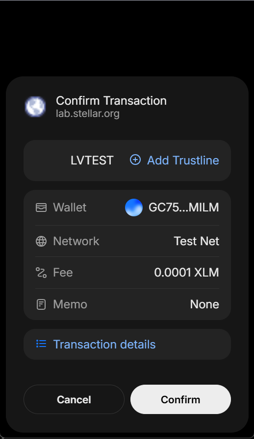
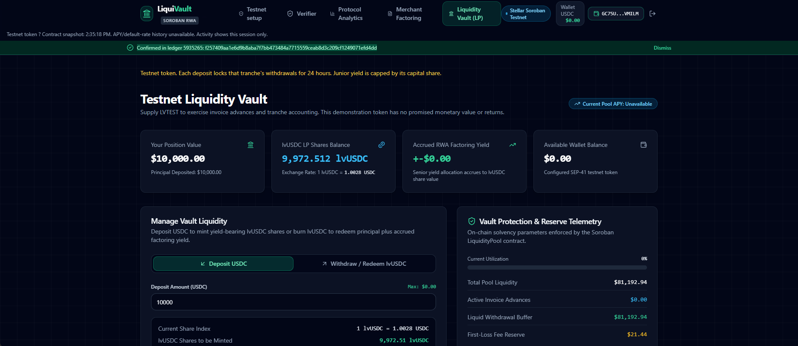
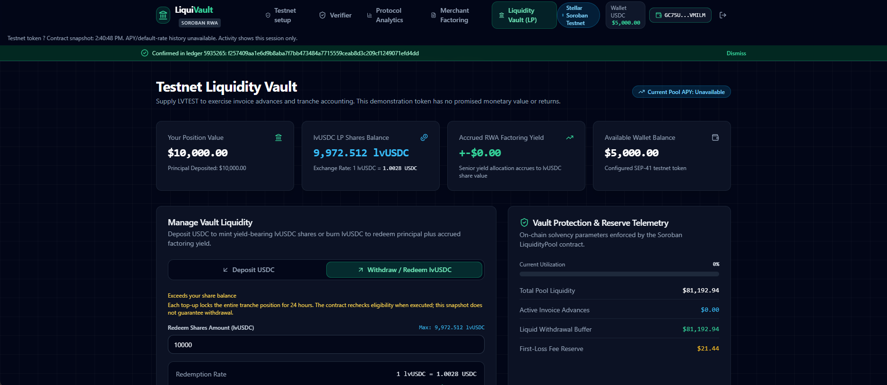
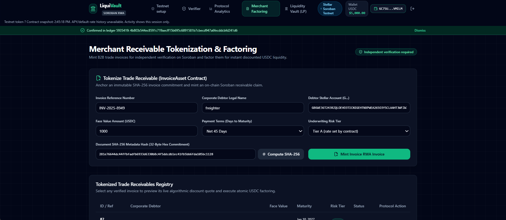
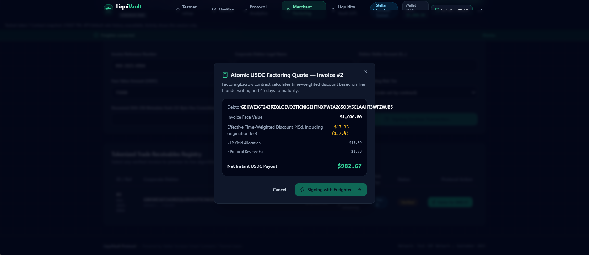
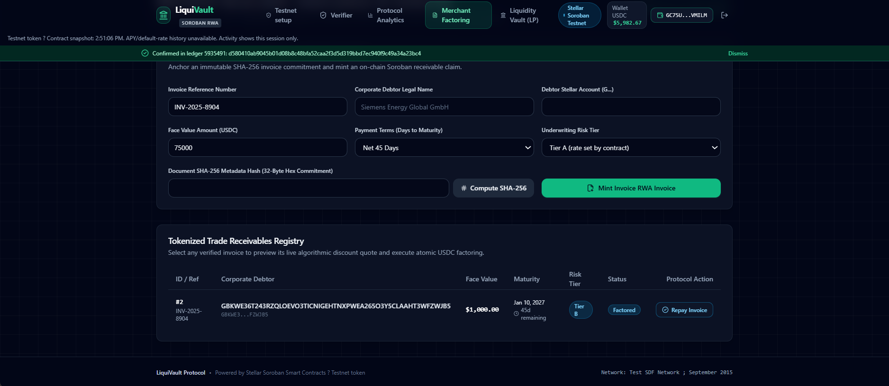
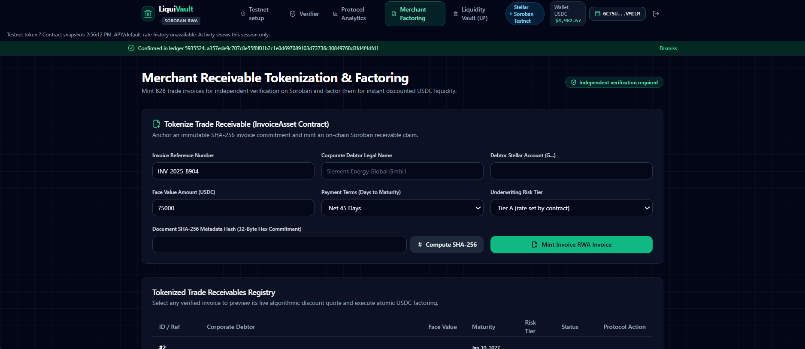
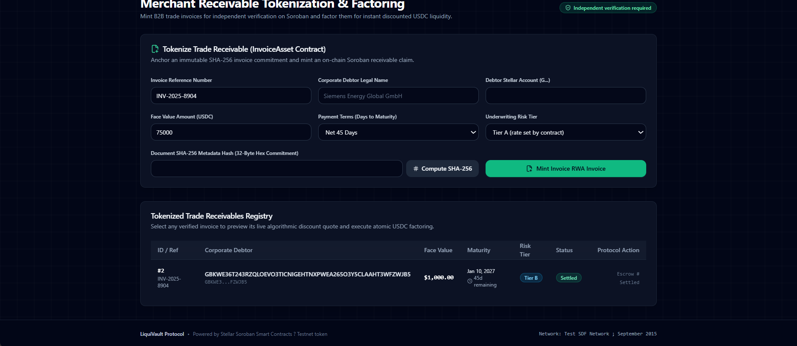
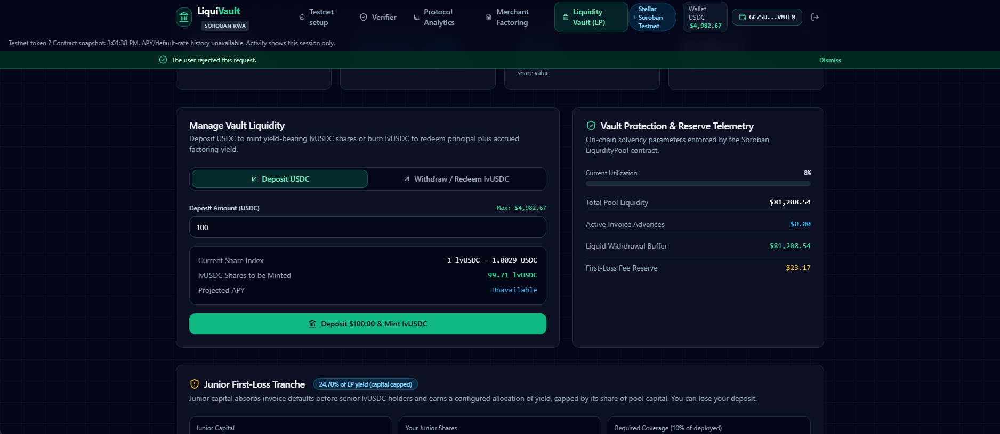

# Evidence required before an appeal

These are LiquiVault's own release gates. They are not published Drips acceptance criteria and do not guarantee selection.

Run `node scripts/check-appeal-gates.mjs` from the repository root to validate the recorded evidence and list pending gates. CI runs this structural check. Use `node scripts/check-appeal-gates.mjs --require-complete` when checking readiness: it exits unsuccessfully while wallet or independent-session evidence is missing. Neither command verifies transactions against a live network or independently attests to a session. Add only actual, consented session records to `status.json`.

| Gate | Current result | Evidence |
| --- | --- | --- |
| Network archival and recovery | Passed three times on separately instrumented localhost fixtures | [First run](archival-recovery.json), [fresh replay](archival-recovery-replay.json), [13 November rerun](archival-recovery-final.json) |
| Actual wallet-extension lifecycle | In progress; no completed session claimed here | [Wallet protocol](../wallet-demo.md) |
| Independent developer/user validation | Confirmed wallet-to-wallet transfer with an approved, consented tester review | [Session receipt](independent-wallet-transfer-2026-11-28.json) · [Tester and maintainer reviews](../SESSION_WORKSHEET.md#tester-note-for-the-28-november-2026-session) |

## Recovery scope

All three runs confirmed normal expiry of a pool instance and LP position, a simulation-provided automatic-restoration footprint, rejected signing without restoring state, then confirmed restoration and withdrawal with an exact token-balance delta. RPC returned expired entries with TTL zero; disappearance from RPC was not assumed. The second and third runs used the reusable runner from fresh networks and stopped their own containers on completion. The 13 November rerun confirmed withdrawal at ledger 765 with a token-balance increase of 501378205768 base units.

The network used Protocol 28 and a pinned Quickstart image whose RPC supports protocol hosts 28/29. The fixture uses 256-ledger minimum persistence and cloned contracts with 32-ledger thresholds, 256-ledger extension targets and a one-second withdrawal lock. Canonical contract sources and public testnet deployment records were unchanged. Each receipt lists these patches and the fixture WASM/source hashes. This proves the exercised recovery path on an instrumented local network; it does not prove production timing, every archival scenario, or a manual fallback.

Local transaction hashes cannot be resolved on public testnet explorers. Reproduce the fixture using the [contract instructions](https://github.com/MoscowDev/liquivault-contracts/blob/main/docs-local-integration.md). A browser fixture, CLI signature, AI review or maintainer-run session must never be recorded as independent-person validation.

## Live wallet session

On 26 November 2026 the maintainer completed the hosted-demo lifecycle with the official Varial wallet extension (formerly Freighter) on Testnet: deposit, invoice issuance, separate verifier approval, factoring and settlement, plus one rejected signature. Every hash was checked on Horizon. See [wallet-freighter-2026-11-26.json](wallet-freighter-2026-11-26.json), including what was not recorded.

### Screenshots

Cropped to the page or wallet popup. Captions match the [wallet record](wallet-freighter-2026-11-26.json).

| Step | Screenshot |
| --- | --- |
| Wallet confirms the LVTEST trustline |  |
| Deposit confirmed in ledger 5935265 |  |
| Withdrawal blocked: share balance and 24-hour lock notice |  |
| Invoice 2 minted in ledger 5935419 |  |
| Factoring quote: net payout 982.67 |  |
| Invoice 2 factored in ledger 5935491 |  |
| Repayment confirmed in ledger 5935524 |  |
| Invoice 2 settled |  |
| Rejected signature |  |

The rejection screenshot shows the message in the hosted build's green, success-styled banner. Frontend commit `d5d5392` renders errors in red and unknown outcomes in amber; the hosted demo needs a redeploy to pick it up. The [Stellar Lab result](wallet-2026-11-26/02-trustline-submitted.png) for the trustline is also kept.
